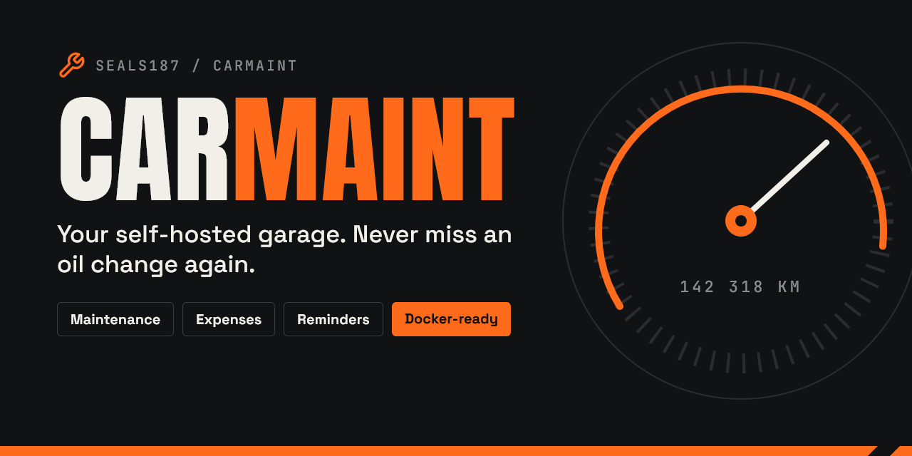
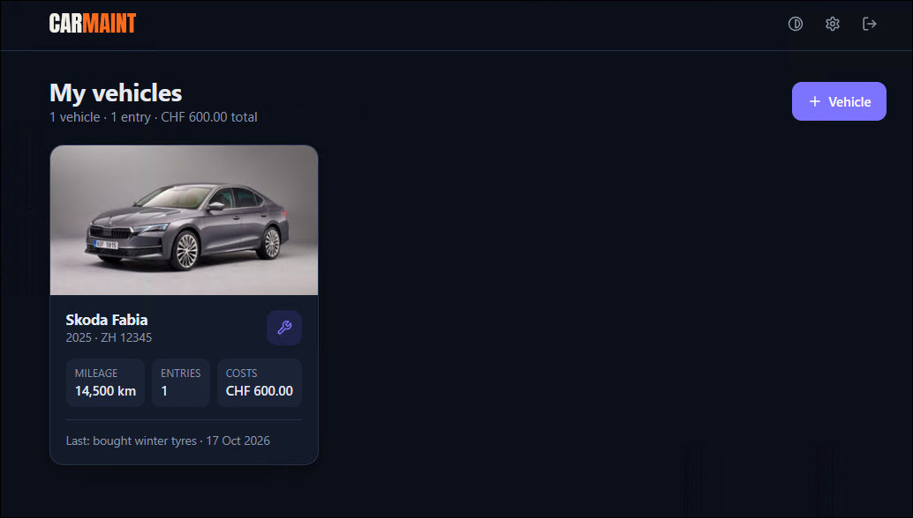
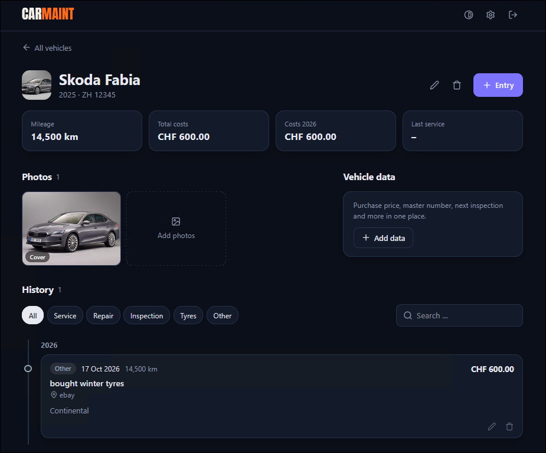

# CarMaint

[](https://github.com/seals187/carMaint/releases)
[](https://cm-demo.seals187.com)
[](https://discord.gg/8DU3XPFJQ6)

A lightweight, self-hosted maintenance log for your vehicles: services, repairs, inspections,
costs, photos and receipts – with multi-user login. Runs as a single Docker container.

**Stack:** plain HTML/CSS/JS · [PocketBase](https://pocketbase.io) (SQLite) · Docker (amd64, arm64, armv7)

<p align="center">
  
  
</p>

**Live demo:** [cm-demo.seals187.com](https://cm-demo.seals187.com) – sign in with user `demo`, password `demodemo`.
The demo container is deleted and recreated every 30 minutes, so all changes are reset.

## Installation

Requires Docker with the Compose plugin.

**Linux**

```bash
mkdir carmaint && cd carmaint
curl -fsSLO https://raw.githubusercontent.com/seals187/carMaint/main/docker-compose.yml
curl -fsSL  https://raw.githubusercontent.com/seals187/carMaint/main/.env.example -o .env
nano .env            # set at least ADMIN_PASSWORD
docker compose up -d
```

**Windows (Docker Desktop, PowerShell)**

```powershell
mkdir carmaint; cd carmaint
Invoke-WebRequest https://raw.githubusercontent.com/seals187/carMaint/main/docker-compose.yml -OutFile docker-compose.yml
Invoke-WebRequest https://raw.githubusercontent.com/seals187/carMaint/main/.env.example -OutFile .env
notepad .env         # set at least ADMIN_PASSWORD
docker compose up -d
```

Then open `http://localhost:8090` (or `http://<server-ip>:8090`) and sign in with the admin account from `.env`.

## Configuration

All settings live in `.env` – see [`.env.example`](.env.example) for every option. The most important ones:

| Variable | Description |
|---|---|
| `ADMIN_USERNAME` / `ADMIN_PASSWORD` | First user (admin), created on first start. Password min. 8 characters |
| `CARMAINT_VERSION` | `latest`, a fixed version such as `0.1.3`, or `edge` |
| `PORT` | Host port (default `8090`) |
| `DEFAULT_CURRENCY` | `EUR`, `CHF` or `USD` |
| `DEFAULT_LANGUAGE` | `de` or `en` – users can switch the language in the app |
| `TRUSTED_PROXY_HEADERS` | e.g. `X-Forwarded-For` when running behind a reverse proxy |

Apply changes with `docker compose up -d`. Forgot the admin password? Set `ADMIN_RESET_PASSWORD=true`
and a new `ADMIN_PASSWORD`, restart, then set it back to `false`.

For access from the internet, put a reverse proxy with HTTPS in front (e.g. Caddy, Traefik, nginx).

## Usage notes

- **Users:** admins manage accounts under *Settings → Users*. Every user only sees their own vehicles.
- **Demo account:** `DEMO_USERNAME` / `DEMO_PASSWORD` create a restricted user on startup;
  `DEMO_DISABLED` hides settings such as *Change password* for it (see [`.env.example`](.env.example)).
- **Backup:** *Settings → Backup* exports/imports all data of a user as one JSON file.
  All server data is stored in the Docker volume `carmaint_data`.
- **Update:** `docker compose pull && docker compose up -d`

## Community

<a href="https://discord.gg/8DU3XPFJQ6"></a>

Have a question, an idea or found a bug? Want to contribute code, translations or feedback?
The Discord server is the place to talk about CarMaint – everyone is welcome.

## Development

```powershell
copy .env.example .env
powershell -ExecutionPolicy Bypass -File .\dev.ps1   # Windows, runs on http://localhost:8090
```

Or build the image locally: `docker build -t ghcr.io/seals187/carmaint:dev .`

| Folder | Content |
|---|---|
| `pb_public/` | Website (HTML, CSS, JS) |
| `pb_migrations/` | Database schema and access rules |
| `pb_hooks/` | Server logic (reads `.env`, creates the admin) |

## Releases

Versioning follows [SemVer](https://semver.org/) (`0.x` = initial development); changes are listed in
[CHANGELOG.md](CHANGELOG.md). Pushing a tag `vX.Y.Z` publishes the Docker image
(`ghcr.io/seals187/carmaint`) and a GitHub release. Pushes to `main` publish the `edge` image.
